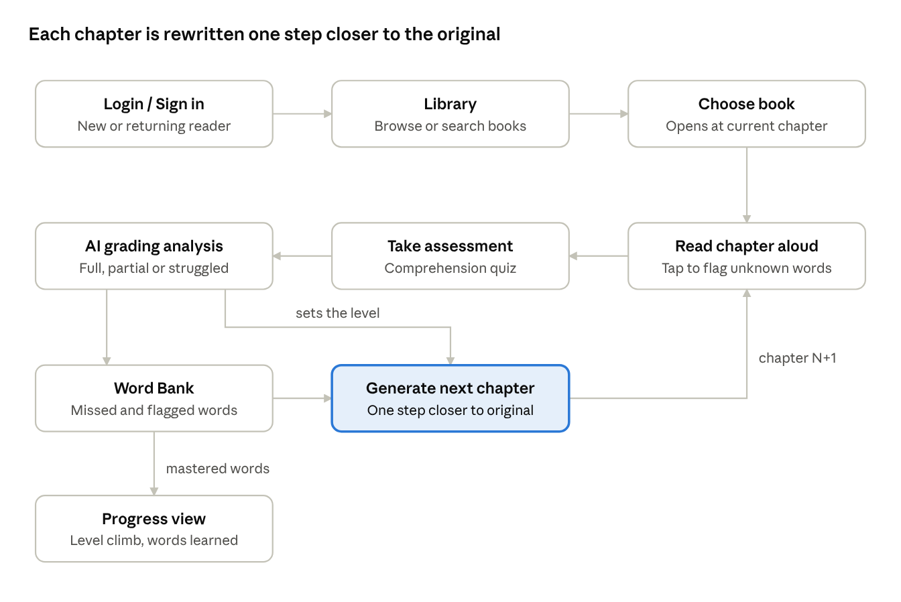

<!-- Ingested 2026-10-17 17:58 from ReadingAppFlow.docx (team, @Colin). Immutable source. -->
# Reading App Flow

Oct 17, 2026 · @Colin Onevathana

An adaptive read-aloud app for HackTN26: each chapter is rewritten one
small step closer to the author's original text, based on how well the
reader understood the last one.

## At a glance

reading loop · 9 steps, repeats every chapter

Entry runs once; the loop from reading to the next chapter repeats until
the reader reaches the author's original text.

## Entry flow

There is no placement test. Every reader goes straight to the library,
and chapter 1 does the calibrating.

1.  **Login / Sign in.** New users create an account; returning users
    sign in.

2.  **Library.** Browse the app's book catalog or use the search bar.

3.  **Choose book.** Opens the book at the reader's current chapter.

4.  **Start reading.** Chapter 1 is served at a default simplified level
    (L1). Its quiz results set the level for everything after.

## Reading session

Each chapter produces two signals: how the reader read it aloud, and how
well they understood it.

- **Read aloud.** The reader reads the chapter out loud. Speech is
  transcribed and compared word by word against the chapter text to
  catch mispronounced or skipped words.

- **Flag words.** While reading, the reader can tap any word they don't
  know. Flagged words go straight to the Word Bank.

- **Take assessment.** After the chapter, a short quiz checks
  comprehension. Questions target the chapter's plot points and its most
  complex words, which the app detects from the chapter text before the
  reader starts.

## AI grading analysis

The AI combines both signals into one comprehension result per chapter,
which decides the next chapter's level.

| Input                 | What it measures                                         |
|-----------------------|----------------------------------------------------------|
| Read-aloud transcript | Words mispronounced or skipped, against the chapter text |
| Assessment answers    | Understanding of plot and of the chapter's complex words |
| Flagged words         | Words the reader said they didn't know                   |

Output: a result of **Fully understood**, **Partly understood** or
**Struggled**, plus the list of missed words sent to the Word Bank.

## Word Bank

The Word Bank holds every word this reader hasn't mastered yet, and it
feeds directly into how the next chapter is written.

1.  **Words enter** two ways: the reader got them wrong (in the quiz or
    reading aloud), or the reader flagged them as unknown.

2.  **Words are reinforced.** The next chapter reuses them with context
    clues or an inline definition, so the reader sees them again in an
    easier setting.

3.  **Words graduate.** Once the reader reads or answers a word
    correctly in a later chapter, it leaves the Word Bank. From then on
    it appears in the author's original form.

4.  **Graduated words** count toward Word tracking: the running total of
    words this reader now knows.

## Next-chapter generation

The LLM rewrites each chapter on the fly, one step at most from the
last, so the reader climbs gradually toward the original text and never
hits a sudden jump.

**Difficulty ladder:** L1 (most simplified) → L2 → L3 → L4 → L5 (the
author's original text).

**Inputs for chapter N+1**

1.  **Original author text** of chapter N+1: the target.

2.  **Simplified version just read** (chapter N): the baseline the new
    chapter is compared against.

3.  **Grading result** for chapter N: decides the direction.

4.  **Word Bank**: words to reinforce in this chapter.

**Level rules**

| Grading result    | Next chapter level                                | Word Bank handling                               |
|-------------------|---------------------------------------------------|--------------------------------------------------|
| Fully understood  | Up one level, or same level if they barely passed | Reinforce remaining bank words                   |
| Partly understood | Same level                                        | Reinforce missed words with context clues        |
| Struggled         | Same level, or down one                           | Extra support: inline definitions for bank words |

**What the LLM does**

- Measures the gap between the baseline and the original: sentence
  length, vocabulary, figurative language.

- Rewrites chapter N+1 at the target level, never more than one step
  from the baseline.

- Keeps plot, names and tone faithful to the author.

- Leaves graduated words in their original form and weaves in Word Bank
  words with support.

**Output:** the chapter N+1 text plus a stored level score, which
becomes the baseline for chapter N+2.

## Progress view and data

The progress view shows the reader climbing the ladder: level per
chapter, words learned, and current Word Bank.

- **Level line:** L1 → L2 → L3 across chapters, showing the climb toward
  the original text. This is the demo moment for judges.

- **Words learned:** the Word tracking total, with words that graduated
  this chapter.

- **Word Bank:** words still being reinforced.

**Data stored per reader (proposed)**

| Record          | Key fields                                                    |
|-----------------|---------------------------------------------------------------|
| Reader          | Account, current book, current chapter                        |
| Chapter version | Book, chapter number, level score, generated text             |
| Session result  | Read-aloud misses, quiz score, grading result                 |
| Word Bank entry | Word, source (wrong or flagged), times seen, graduated yes/no |
